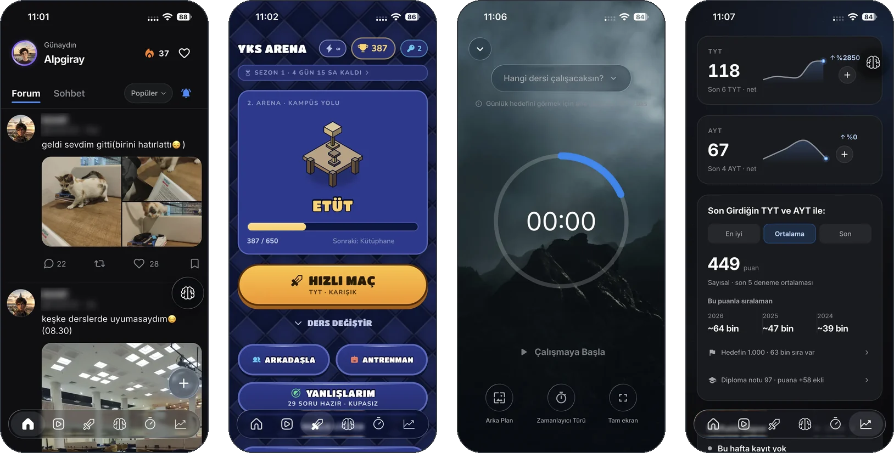
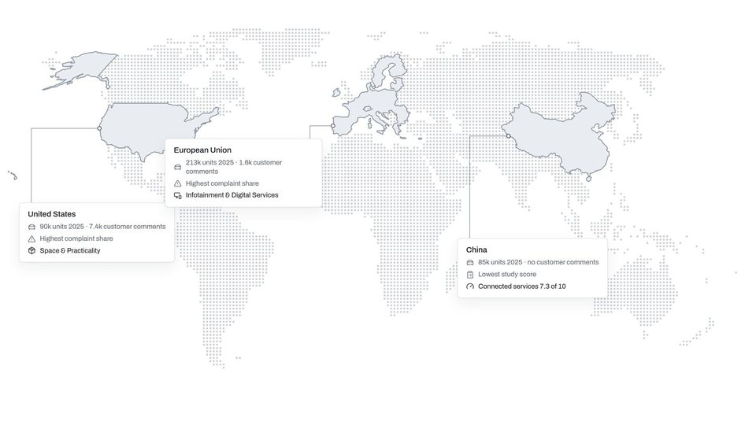
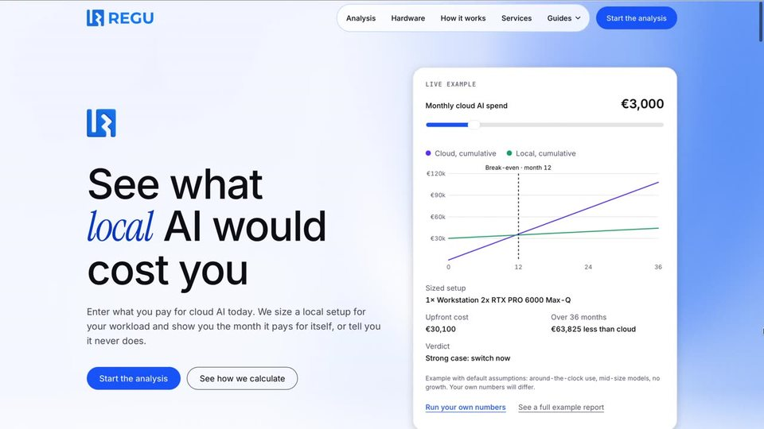

<!--
  ============================================================
  Alpgiray Celik · GitHub Profile README
  Repo: github.com/alpgi1/alpgi1
  Numbers match the portfolio (project-data.ts), as of Oct 2026.
  ============================================================
-->

<div align="center">

<!-- ── HEADER ─────────────────────────────────────────────── -->


<!-- ── TYPING ANIMATION ───────────────────────────────────── -->
<a href="https://alpgiraycelik.me">
  
</a>

<br/>

<!-- ── LINKS ──────────────────────────────────────────────── -->
<a href="https://alpgiraycelik.me">
  
</a>
<a href="https://linkedin.com/in/alpgiray-celik">
  
</a>
<a href="mailto:alpgiray.dev@gmail.com">
  
</a>

</div>

<br/>

<!-- ── ABOUT ──────────────────────────────────────────────── -->

## `~/whoami`

```yaml
name:      Alpgiray Celik
based:     Munich, Germany
study:     B.Sc. Computer Science @ TU Munich (since Oct 2025)
work:      Working student @ Knorr-Bremse · sole developer of Smart System Select
shipped:   Mentor YKS · 100,000+ downloads · 22,000+ monthly / 2,000+ daily active users
building:  REGU · cloud vs. local AI cost analysis, live at reguai.tech
languages: Turkish (native) · German (C1) · English (C1)
```

I build products that end up in front of real people, and I own them end to end:
architecture, release cycle, store submissions and product direction.

Most of my day-to-day work lives in **private repositories**: a production app, my
employer's internal platform and a startup codebase. Where the code can't be public,
the links below go to the live product instead.

<br/>

<!-- ── FEATURED ───────────────────────────────────────────── -->

## `~/featured`

### Mentor YKS · social learning platform for Turkey's university entrance exam

<div align="center">

| **100,000+** | **22,000+** | **7,000+** | **2,000+** |
|:---:|:---:|:---:|:---:|
| downloads | monthly active users | weekly active users | daily active users |

</div>

**Sole engineer and product owner.** Over four months I re-architected Mentor YKS from a
single-purpose question bank into a social learning platform: a content feed students post
to, short-form video lessons, in-app messaging, gamified focus sessions and a real-time
arena mode where students compete on timed subject questions. 1,500+ new users join every
month, and day-one retention is above 25 percent.

`Flutter` `Dart` `NestJS` `TypeScript` `PostgreSQL`

[**App Store**](https://apps.apple.com/de/app/mentor-yks-sosyal/id6686406375) ·
[**Google Play**](https://play.google.com/store/apps/details?id=com.msac.mentoryks) ·
[**mentorsosyal.com**](https://mentorsosyal.com) · *private repositories*

<p align="center">
  
</p>

<sub>Figures as of October 2026, from the App Store and Google Play consoles and in-app analytics.</sub>

<br/>

<!-- ── RECENT ─────────────────────────────────────────────── -->

## `~/recent`

<table>
<tr>
<td width="50%" valign="top">



### Tracepoint
**TUM.ai hackathon · BMW challenge · Oct 2026**

From customer feedback to traceable, approved product requirements for BMW product
managers. One PostgreSQL evidence store over 13,771 classified customer comments, studies,
sales volumes and the BMW Group Report; 57 measurable requirements; an effort engine
whose back-test reproduces 8 of 8 documented BMW decisions. Built in two days by a team of
three: I drove the product and the frontend and integrated it with the backend.

`Python` `FastAPI` `PostgreSQL` `OpenAI` `Next.js` `TypeScript`

[**Repository**](https://github.com/alpgi1/tracepoint) · [**Live demo**](https://alpgi1.github.io/tracepoint/)

</td>
<td width="50%" valign="top">



### REGU
**Live at reguai.tech · private repositories**

Shows a company what running AI on its own hardware would cost compared with the cloud:
hardware sized from a catalogue, break-even, ROI and a three-year TCO, or an honest
"it never pays off". The calculation engine is locked by a golden output shared with a
Python prototype. Started as an EU AI Act compliance engine; now also building an
EU-hosted LLM gateway in Go.

`Next.js` `TypeScript` `Supabase` `Go`

[**reguai.tech**](https://reguai.tech) · [**Chapter one: Regu-EAACC**](https://github.com/alpgi1/Regu-EAACC)

</td>
</tr>
<tr>
<td width="50%" valign="top">

### Smart System Select
**Knorr-Bremse · internal · sole developer**

The internal platform that replaced Excel-based brake test-case configuration in the
braking systems division. Models 20 to 40 parameters against a catalogue of 1,000+
components; building a test case went from 20 to 60 minutes to **under 5**. Requirements
come straight from the mechanical engineers who use it. Rollout to Munich, Krakow and
Hungary planned for Q4 2026.

`Java` `Spring Boot` `React` `MS SQL Server`

*Internal platform, no public link*

</td>
<td width="50%" valign="top">

### Apex Coach
**Live on the App Store**

Offline-first, RPE-driven training app with an AI coach that reads your full training
history. Local-first SQLite with background sync to a Spring Boot backend, and a
progressive overload engine built around RPE instead of fixed percentage tables.

`React Native` `TypeScript` `Spring Boot` `Supabase` `Gemini`

[**App Store**](https://apps.apple.com/us/app/apex-coach-ai-gym-tracker/id6761065591) · [**Repository**](https://github.com/alpgi1/apex-coach)

</td>
</tr>
</table>

<br/>

<!-- ── EARLIER ────────────────────────────────────────────── -->

## `~/earlier`

| Project | What it is | Built with |
|---|---|---|
| [**GTM-Zero**](https://github.com/alpgi1/gtm-zero) | AI sales engineer for technical founders, built in 5 days for the START Munich pitch. Citation-grounded answers to technical objections during a live call, first token under 2 s. | Spring AI · Next.js · pgvector |
| [**ChainSense**](https://github.com/alpgi1/chainsense-scm) | Multi-agent supply chain risk platform: a Risk Analyst and a Strategist agent turn a disruption into a costed recovery plan to approve or reject. | Spring AI · React · pgvector |
| [**Agnes**](https://github.com/alpgi1/Agnes) | Hackathon build: supply chain optimizer for consumer goods companies; every finding is checked against EU food-labelling rules before it reaches the user. | Spring Boot · React · Claude |
| [**Regu&#8209;EAACC**](https://github.com/alpgi1/Regu-EAACC) | REGU's first chapter: RAG over the EU AI Act with hybrid search and a citation gate that refuses rather than guesses. Archived. | Spring AI · pgvector |

<br/>

<!-- ── STACK ──────────────────────────────────────────────── -->

## `~/stack`

<div align="center">

**Languages**


**Backend & Data**


**Frontend & Mobile**


**Tools**


</div>

<br/>

<!-- ── ACTIVITY ───────────────────────────────────────────── -->

## `~/activity`

<div align="center">


<br/><br/>

<!-- Snake: generated daily by .github/workflows/snake.yml into the "output" branch -->
<picture>
  <source media="(prefers-color-scheme: dark)" srcset="https://raw.githubusercontent.com/alpgi1/alpgi1/output/github-snake-dark.svg" />
  <source media="(prefers-color-scheme: light)" srcset="https://raw.githubusercontent.com/alpgi1/alpgi1/output/github-snake.svg" />
  
</picture>

</div>

<br/>

<!-- ── FOOTER ─────────────────────────────────────────────── -->

<div align="center">

### `~/contact`

Based in Munich. Looking for a 13 to 17 week full-time internship from May 2027.

<a href="https://linkedin.com/in/alpgiray-celik">
  
</a>
<a href="mailto:alpgiray.dev@gmail.com">
  
</a>


</div>
